<!-- datasheet:banner -->
<p align="center">
  <picture>
    <source media="(prefers-color-scheme: dark)" srcset=".github/assets/banner-dark.svg">
    
  </picture>
</p>
<!-- /datasheet:banner -->

# ASCII Dino

A terminal Chrome-Dino-style endless runner, written in Python (`curses`) and containerized with Docker.

<!-- datasheet:figure -->
## At a glance

<p align="center">
  <picture>
    <source media="(prefers-color-scheme: dark)" srcset=".github/assets/diagram-dark.svg">
    
  </picture>
</p>

| Characteristic | Detail |
| --- | --- |
| **Run** | `docker build -t ascii-dino . && docker run -it --rm ascii-dino`, or `python3 dino.py` locally |
| **Controls** | `SPACE` / `UP` / `W` jump, `DOWN` / `S` duck, `R` restart, `Q` quit |
| **State** | High score saved to `highscore.txt` next to the script |
| **Requires** | Python 3 with `curses` (built in on macOS and Linux); `-it` gives Docker a TTY for input |
<!-- /datasheet:figure -->

## Run with Docker

```sh
docker build -t ascii-dino .
docker run -it --rm ascii-dino
```

`-it` is required so the container gets an interactive TTY for keyboard input.

## Run locally (no Docker)

```sh
python3 dino.py
```

Requires Python 3 with `curses` (built in on macOS/Linux).

## Controls

- `SPACE` / `UP` / `W` — jump
- `DOWN` / `S` — duck (dodge low-flying birds)
- `R` — restart after game over
- `Q` — quit

High score is saved to `highscore.txt` next to the script.

## License

MIT. See [LICENSE](LICENSE).
