<!-- datasheet:banner -->
<p align="center">
  <picture>
    <source media="(prefers-color-scheme: dark)" srcset=".github/assets/banner-dark.svg">
    
  </picture>
</p>
<!-- /datasheet:banner -->

# ASCII Dino

**An endless runner for your terminal: one dinosaur, a lot of cacti, and birds that show up once you start getting good.**

A Chrome-Dino-style game written in Python (`curses`) and containerised with Docker. The dino, cacti and birds are drawn with braille and half-block characters, in colour where your terminal has it, and the game runs at 120 frames per second.

<!-- datasheet:figure -->
## At a glance

<p align="center">
  <picture>
    <source media="(prefers-color-scheme: dark)" srcset=".github/assets/diagram-dark.svg">
    
  </picture>
</p>

| Characteristic | Detail |
| --- | --- |
| **Run** | `docker build -t ascii-dino . && docker run -it --rm -v ascii-dino-data:/data ascii-dino`, or `python3 dino.py` locally |
| **Controls** | `SPACE` / `UP` / `W` jump, `DOWN` / `S` duck, `1` `2` `3` pick a difficulty, `A` auto-play, `R` restart, `M` menu, `Q` quit |
| **Modes** | Easy, Normal and Hard; birds appear once your score passes 350, 260 or 150; Auto-Play lets the dino run itself |
| **State** | One high score, saved next to the script or in `/data` in Docker (mount a volume to keep it); `HIGHSCORE_FILE` moves it |
| **Requires** | Python 3 with `curses` (built in on macOS and Linux); `-it` gives Docker a TTY for input |
<!-- /datasheet:figure -->

## Quick start

```sh
docker build -t ascii-dino .
docker run -it --rm -v ascii-dino-data:/data ascii-dino     # -it gives the game a keyboard; the volume keeps your high score
```

No Docker? `python3 dino.py` runs it directly on macOS or Linux.

## Features

* **Three difficulties:** Easy, Normal and Hard change how fast the game starts, how fast it can get, how far apart the obstacles are and when the birds arrive.
* **Auto-Play:** switch it on from the menu or mid-game and watch the dino play itself.
* **Birds** fly in once your score passes a threshold that depends on the difficulty. Duck under the low ones.
* **It speeds up:** the pace ramps with your score, up to a top speed for each difficulty.
* **A saved high score,** shown on the menu and the score line.

## Controls

| Where | Key | Action |
|---|---|---|
| Menu | `1` / `2` / `3` | Pick Easy, Normal or Hard |
| Menu | `A` | Turn Auto-Play on or off |
| Menu | `SPACE` / `ENTER` | Start |
| Playing | `SPACE` / `UP` / `W` | Jump |
| Playing | `DOWN` / `S` | Duck |
| Playing | `A` | Toggle Auto-Play |
| Game over | `R` | Play again on the same difficulty |
| Game over | `M` | Back to the menu |
| Anywhere | `Q` | Quit |

## Difficulties

| | Easy | Normal | Hard |
|---|---|---|---|
| Starting speed | 24 | 30 | 39 |
| Top speed | 60 | 84 | 108 |
| Birds appear after a score of | 350 | 260 | 150 |

## Run with Docker

```sh
docker build -t ascii-dino .
docker run -it --rm -v ascii-dino-data:/data ascii-dino
```

`-it` is required so the container gets an interactive TTY for keyboard input. The image saves the high score in `/data/highscore.txt`, so mount a volume there, as above, to keep it between runs. Without the volume, `--rm` throws the score away with the container.

## Run locally (no Docker)

```sh
python3 dino.py
```

Requires Python 3 with `curses` (built in on macOS and Linux). The high score is saved in `highscore.txt` next to the script (it is git-ignored). Set `HIGHSCORE_FILE=/some/path` to keep it somewhere else.

## Typical application

* **A coffee break:** `python3 dino.py`, pick Normal, beat your own number.
* **A terminal screensaver:** turn Auto-Play on, pick Hard, and leave it running.
* **Show it off over SSH:** it needs only a terminal and Python.

## Absolute maximum ratings

| Parameter | Limit |
|---|---|
| Frame rate | 120 FPS |
| Difficulties | 3 |
| Top speed | 60 / 84 / 108 (Easy / Normal / Hard) |
| High scores kept | 1, shared by all difficulties |
| Dinosaurs harmed | 0 |

## Errata

* There is one high score for all three difficulties, and a score earned with Auto-Play counts too: the game does not tell the dino's own runs from yours.
* Windows has no built-in `curses`, so run it in WSL or in Docker there.

## License

MIT. See [LICENSE](LICENSE).

<!-- datasheet:footer -->
---

<p align="center">
  <a href="https://github.com/S-k404/fetch3d">&larr; U13 fetch3d</a> &middot;
  <a href="https://github.com/S-k404/S-k404">SK-404 index</a> &middot;
  <a href="https://github.com/S-k404/esp32-sensor-probe">U15 esp32-sensor-probe &rarr;</a>
</p>
<!-- /datasheet:footer -->
